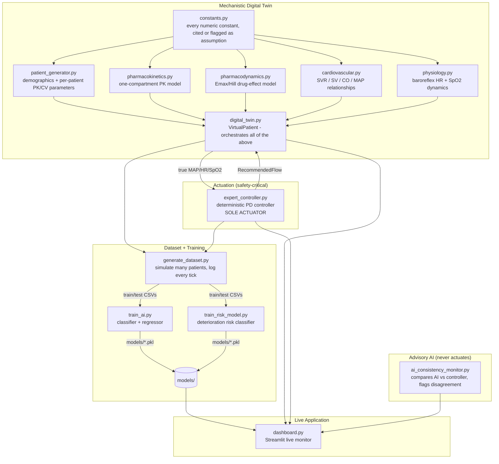
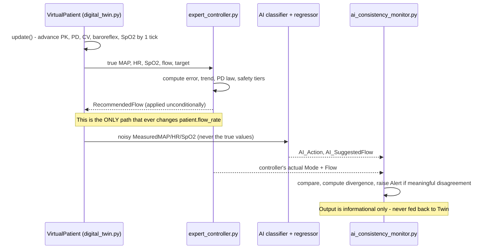

# Smart AI Infusion Pump — Project Documentation

**A mechanistic digital twin of norepinephrine (vasopressor) infusion in septic shock, with a safety-critical rule-based controller and an advisory AI layer.**

This document is written to be read end-to-end before a supervisor meeting. It covers the terminology, every equation, every assumption vs. citation, the full code flow, the meaning of every column in the training data, and the rationale behind the major design decisions (including bugs found and fixed along the way — these are worth knowing because they show *why* the system is built the way it is, not just *that* it is).

---

## 1. Executive Summary

### 1.1 What this project is

A simulation of a patient in septic shock receiving **norepinephrine** (a vasopressor drug) through an infusion pump, plus software that decides how fast to infuse it. There is no real hardware and no real patient data — every "patient" is a simulated one, generated from a mechanistic model whose parameters are drawn from published clinical literature wherever possible.

The system has four layers:

1. **Digital twin** — simulates a patient's physiology second-by-second: how the drug moves through the bloodstream (pharmacokinetics), how it acts on blood vessels (pharmacodynamics), and how that changes blood pressure, heart rate, and oxygen saturation.
2. **Expert controller** — a deterministic, rule-based algorithm that is the **only** thing allowed to set the pump's flow rate. It is a classical control-theory PD (proportional–derivative) controller, not a machine-learning model.
3. **AI advisory layer** — two machine-learning models (trained on simulated data) that independently *suggest* what the flow rate/action should be, purely for comparison and clinician review. They never touch the pump.
4. **Deterioration risk model** — a third, separate ML model that predicts whether the patient will deteriorate in the next 30 seconds — a genuinely forward-looking task the rule-based controller cannot do, since it only ever sees the current instant.
5. **Live dashboard** — a Streamlit web app that runs all of the above in real time and visualizes it.

### 1.2 Why the architecture is split this way (the central safety argument)

> **The AI never actuates the pump. The deterministic controller is the only thing that ever sets the flow rate.**

This is the single most important design decision in the project, and it is enforced in code, not just in prose: `expert_controller.py`'s output is applied unconditionally to the patient (`patient.flow_rate = expert_decision["RecommendedFlow"]`), and the AI models' predictions only ever flow into `ai_consistency_monitor.py`, which produces a comparison/alert, never a command. If your supervisor asks "what happens if the AI is wrong?" — the answer is: nothing happens to the patient, because the AI's output is never wired to actuation. It is presented as a second opinion a clinician can review.

### 1.3 What is genuinely novel here vs. what is imitation

Two of the three learned models are **imitation learning**: they are trained to predict what the deterministic controller would have done (`AI_Action`, `RecommendedFlow`), given only the noisy sensor readings a real monitor would have. Their ceiling is "guess the controller's output from noisy inputs" — useful as a plausibility-check/second-opinion layer, not as a source of new clinical insight.

The **risk model** is different in kind: its label (`WillDeteriorate`) is built by looking at each simulated patient's own *future* trajectory — information the controller structurally cannot have, since it only ever reacts to the current tick. This is a genuine forward-looking prediction task, not a copy of existing logic.

---

## 2. Glossary of Terms

| Term | Meaning |
|---|---|
| **MAP** | Mean Arterial Pressure (mmHg) — the average blood pressure over a cardiac cycle; the primary variable this whole system is trying to control. |
| **Norepinephrine (levophed)** | The vasopressor drug being infused. Raises blood pressure by constricting blood vessels (increasing vascular resistance). |
| **Vasopressor** | A drug that raises blood pressure by constricting blood vessels. |
| **Septic shock** | A life-threatening condition where infection causes blood vessels to inappropriately dilate, dropping blood pressure and organ perfusion. |
| **SVR** | Systemic Vascular Resistance (dyn·s/cm⁵) — how constricted the blood vessels are. Higher SVR → higher blood pressure (for the same cardiac output). This is what norepinephrine directly raises. |
| **CO** | Cardiac Output (L/min) — volume of blood the heart pumps per minute. `CO = HR × SV`. |
| **SV** | Stroke Volume (mL) — volume of blood pumped per heartbeat. |
| **HR** | Heart Rate (beats/min). |
| **SpO2** | Peripheral oxygen saturation (%) — how much of the blood's hemoglobin is carrying oxygen. |
| **CVP** | Central Venous Pressure (mmHg) — pressure in the large veins near the heart; used as a small constant offset in the MAP equation here. |
| **PK** | Pharmacokinetics — what the body does to the drug (absorption, distribution, clearance). Governs the drug's *concentration* over time. |
| **PD** | Pharmacodynamics — what the drug does to the body. Governs the drug's *effect* given its concentration. |
| **Cp** | Plasma drug concentration (mcg/L) — how much norepinephrine is in the blood at a given moment. The output of the PK model and the input to the PD model. |
| **Vd** | Volume of distribution (L) — a PK parameter describing how "diluted" the drug appears to be in the body. |
| **CL / Clearance** | Rate (L/min) at which the body removes the drug from the blood. |
| **ke** | Elimination rate constant = CL / Vd (per minute). |
| **Emax model / Hill equation** | The standard PD model shape used here: effect rises with concentration up to a maximum (`Emax`), following an S-curve controlled by `EC50` and the Hill coefficient. |
| **EC50** | The plasma concentration at which the drug produces half of its maximum effect. |
| **Hill coefficient (γ)** | Controls how sharply the dose-response curve rises (sigmoidicity). |
| **Baroreflex** | The body's own feedback loop: when blood pressure drops, the nervous system raises heart rate to compensate, and vice versa. |
| **SAPS II** | Simplified Acute Physiology Score II — a real ICU illness-severity score (0–~160). Used here only as an internal parameter-generation lever, not as an AI input (see §4.10). |
| **Deadband** | A tolerance zone around the target (±3 mmHg here) inside which the controller does not treat the patient as "off target" — prevents rapid oscillation ("chattering") between Increase/Decrease. |
| **PD controller** (control theory sense — not to be confused with Pharmacodynamics above) | Proportional–Derivative controller: a control law that adjusts an output based on (a) how far off target you currently are (proportional/error term) and (b) how fast you're approaching/leaving target (derivative/trend term). |
| **Shock Index** | HR ÷ MAP — a simple bedside indicator of hemodynamic instability; higher values suggest worse shock. |
| **Perfusion Index** (as used here) | `MAP × SpO2 / 100` — a simple composite used as a model feature, not a validated clinical perfusion index. |
| **Oxygen Deficit** (as used here) | `100 − SpO2` — how far below full saturation the patient is. |
| **VTBI** | Volume To Be Infused — the total volume an infusion pump is programmed to deliver before stopping (real pump terminology). |
| **KVO** | Keep Vein Open — the very low background flow rate (typically 1–5 mL/hr) real infusion pumps run to prevent an IV catheter from clotting, when no drug is otherwise indicated. **Important:** in this codebase KVO is a documented reference constant (`KVO_RATE_ML_HR`), but it is *not* applied as a floor on the norepinephrine dose — see §10.2 for why that was a bug. |
| **SSC** | Surviving Sepsis Campaign — the internationally recognized clinical practice guideline for sepsis/septic shock management. Source of this project's default 65 mmHg MAP target. |
| **SEPSISPAM** | The randomized controlled trial (Asfar et al., NEJM 2014) that compared a 65–70 mmHg vs. 80–85 mmHg MAP target in septic shock. Source of this project's adjustable target *range*. |
| **RF / Random Forest** | The machine-learning algorithm used for all three trained models here (`RandomForestClassifier` / `RandomForestRegressor` from scikit-learn) — an ensemble of decision trees. |
| **Feature importance** | A Random Forest diagnostic showing how much each input column contributed to the model's decisions, on average across all its trees. |
| **Imitation learning** | Training a model to reproduce another decision-maker's outputs (here: the deterministic controller), rather than to discover new patterns. |
| **Partial observability** | The property that an agent (here, the AI models and even the controller) can only see some of the system's true state — e.g., no one can measure SVR, cardiac output, or plasma drug concentration at the bedside in real life, so those are hidden from the models even though the simulation itself tracks them internally. |

---

## 3. System Architecture

### 3.1 Module map



### 3.2 The core safety loop (every simulated second)



### 3.3 File inventory

| File | Role |
|---|---|
| `constants.py` | Every numeric constant used anywhere in the twin, each labeled `[CITED]`, `[DERIVED]`, or `[ASSUMPTION]` with its source. |
| `patient_generator.py` | Generates one virtual patient's demographics and individual PK/CV parameters from their clinical `Profile`. |
| `pharmacokinetics.py` | One-compartment PK model: drug concentration over time. |
| `pharmacodynamics.py` | Emax/Hill model: drug effect from concentration. |
| `cardiovascular.py` | SVR → SV → CO → MAP relationships. |
| `physiology.py` | Baroreflex (HR) and SpO2 dynamics. |
| `digital_twin.py` | `VirtualPatient` class — orchestrates the full per-tick update chain. |
| `expert_controller.py` | The deterministic PD controller — the sole actuator. |
| `ai_consistency_monitor.py` | Compares AI advisory output to the controller's actual decision. |
| `generate_dataset.py` | Runs many simulated patients and logs every tick to CSV, building the two training datasets. |
| `train_ai.py` | Trains the AI_Action classifier and RecommendedFlow regressor. |
| `train_risk_model.py` | Trains the deterioration-risk classifier. |
| `dashboard.py` | Live Streamlit visualization of the whole pipeline. |
| `data/train_patients.csv`, `data/test_patients.csv` | Generated simulation logs — the "training AI sheet." |
| `models/*.pkl` | The three trained models (joblib-serialized). |
| `figures/*` | Confusion matrices, ROC curve, feature-importance plots, and metrics JSON. |

---

## 4. Module-by-Module Documentation

### 4.1 `constants.py` — the single source of truth for every number

Every constant is tagged:

- **`[CITED]`** — taken directly from a named, checkable source.
- **`[DERIVED]`** — computed from a cited source via a stated formula.
- **`[ASSUMPTION]`** — not backed by a specific source; either a standard modeling convention or a value tuned for stable simulation behavior. Explicitly flagged so it is never mistaken for a literature value.

This file is the answer key if your supervisor asks "where does this number come from?" — every single constant has a comment immediately above it citing its source or admitting it's an assumption. See §6 for the full table.

### 4.2 `patient_generator.py` — building one virtual patient

For each patient, in order:

1. **Demographics** are drawn: age (22–85 uniform), sex (M/F), weight (45–120 kg uniform), height (150–195 cm uniform). These are recorded because a real ICU chart would have them, and because weight is *required* to compute a weight-based dose — but per Beloeil et al. (2005), weight, sex, and group did **not** significantly affect this drug's clearance, so only **age** is actually wired into the PK model.
2. **Clearance (CL)** is computed in three steps:
   - A severity-driven baseline is linearly interpolated between 3.0 L/min (least severe, SAPS II 20) and 0.9 L/min (most severe, SAPS II 60), per Beloeil et al.'s reported relationship.
   - An age adjustment reduces clearance for patients over 25, based on Esler et al.'s finding that older adults clear norepinephrine ~22–27.5% more slowly, floored at 70% of the young-adult value beyond age 67 (no extrapolation past the studied range).
   - A generic **log-normal inter-individual variability** term (25% CV) is applied, since Beloeil et al. did not report a per-patient variability magnitude and this is a standard population-PK convention.
3. **Volume of distribution (Vd)** is fixed at 8.8 L for everyone (matches the FDA label and is cross-validated against Beloeil's own reported CL/half-life values) — not weight-scaled, again per Beloeil's finding.
4. **Baseline SVR (SVR₀)** is drawn from a profile-specific range (see §6) anchored to two septic-shock SVR studies (Landry et al. 1997; Melo & Peters 1999).
5. **Baseline MAP (MAP₀)** is drawn from a profile-specific range (Healthy: normal 70–100 mmHg; Mild/Moderate/Severe: proportional bands below the 65 mmHg shock threshold). **Baseline cardiac output (CO₀) is then *derived*** from MAP₀ and SVR₀ via the MAP equation rearranged, rather than sampled independently. **This fixes a real bug** — see §10.1.
6. **Baseline stroke volume (SV₀)** is likewise derived from CO₀ and the sampled heart rate, for the same reason (avoids inconsistent independently-sampled HR/SV/CO combinations) — see §10.1.
7. **Blood volume fraction** — 100% for Healthy, decreasing modestly for sicker profiles (vasodilatory shock is not primarily a volume-loss process, so this reduction is deliberately smaller than the SVR reduction).
8. **Baroreflex setpoint (MAP_set)** — the patient's own "premorbid normal" MAP the baroreflex is always trying to defend, drawn from the normal range (70–100 mmHg) *regardless of profile* — the gap between this and the patient's actual (shock-depressed) MAP is exactly what drives the compensatory tachycardia seen in real shock patients.

### 4.3 `pharmacokinetics.py` — where does the drug go?

**Model:** standard one-compartment IV infusion model.

```
dCp/dt = R/Vd - ke·Cp        where ke = CL/Vd
```

- `Cp`: plasma concentration (mcg/L)
- `R`: mass input rate (mcg/min) — converted from the pump's flow rate (mL/hr) using the real premix concentration, **16 mcg/mL** (a standard commercial norepinephrine premix: 4 mg in 250 mL D5W)
- `Vd`: volume of distribution (8.8 L, fixed)
- `CL`: this patient's clearance (from `patient_generator.py`)

Two conversion functions bridge pump units and PK units:

```
R (mcg/min) = flow (mL/hr) × 16 / 60
```

and its inverse, used by the controller to convert a desired dosing step back into a pump flow-rate change.

Integration is done with simple Euler stepping at the simulation's 1-second tick rate (converted internally to minutes for the ODE).

### 4.4 `pharmacodynamics.py` — what does the drug do?

**Model:** classic Emax (Hill) equation, the literature-standard structure for this exact drug (Beloeil et al. also fit this shape to their own MAP-vs-concentration data):

```
E = Emax · Cp^γ / (EC50^γ + Cp^γ)
```

- `E`: dimensionless fractional effect (used downstream to scale SVR)
- `Emax = 1.2` — maximum fractional increase in SVR **[ASSUMPTION]**
- `EC50 = 6.0` mcg/L — concentration for half-maximal effect **[ASSUMPTION, but calibrated]**
- `γ` (Hill coefficient) `= 1.5` **[ASSUMPTION]**

The exact published `EC50`/`Emax`/`γ` values from Beloeil et al.'s own Emax fit were not obtainable (paywalled full text; a search-snippet fragment showing "EC50 = 70 µg/mL" was judged almost certainly a text-extraction error, since that concentration is physiologically implausible for this drug). Instead, `EC50` was calibrated so that *typical* clinical doses (2–4 mcg/min at good clearance) sit in the therapeutic-but-non-saturated part of the curve, with saturation only approached near the clinical dosing ceiling — the expected qualitative shape, back-derived from the PK model's own realistic concentration range rather than picked blindly.

### 4.5 `cardiovascular.py` — from drug effect to blood pressure

Four standard hemodynamic relationships (Guyton & Hall; Klabunde):

```
SVR = SVR0 × (1 + E)
SV  = SV0 × (BV / BV0)
CO  = (HR × SV) / 1000        mL/beat × beats/min -> L/min
MAP = CVP + (SVR × CO) / 80
```

The last equation is the standard clinical formula `SVR = 80 × (MAP - CVP) / CO`, rearranged to solve for MAP. `CVP` is held fixed at 4.0 mmHg (a documented simplification — real CVP varies 2–8 mmHg but is not separately modeled here).

The stroke-volume equation is a simplified linear proxy for the Frank-Starling mechanism (preload → stroke volume), not the full curve.

### 4.6 `physiology.py` — heart rate and oxygen

**Baroreflex (heart rate):**

```
dHR/dt = k·(HRset - HR) - G·(MAP - MAPset)
```

- `k = 0.15`, `G = 0.30` **[ASSUMPTION]** — the ODE *structure* is standard in cardiovascular control literature, but no single clean numeric gain in these units was found published, so both constants are tuned for stable simulation behavior, not measured.
- Intuition: HR relaxes toward its own setpoint, but is pulled up when current MAP is below the patient's personal defended setpoint (and vice versa) — this is what produces realistic compensatory tachycardia in shock.

**SpO2 (heuristic, not mechanistic):**

- If MAP < 65 mmHg: SpO2 slowly **falls** (poor perfusion → poor oxygenation).
- If MAP ≥ 65 mmHg: SpO2 slowly **recovers**.
- Explicitly documented as a directionally-correct heuristic, not a validated oxygen-delivery model (true oxygen delivery would require modeling `DO2 = CO × CaO2`, which is out of scope).
- **This slow recovery rate is the direct cause of a real bug found and fixed in the controller** — see §10.3.

### 4.7 `digital_twin.py` — the `VirtualPatient` orchestrator

`VirtualPatient.__init__()` builds one patient: draws demographics/PK/CV parameters (via `patient_generator.py`), sets an initial MAP/HR/SpO2 consistent with those parameters (severity "falls out" of the SVR/CO relationship rather than being artificially forced low), and sets a target MAP — defaulting to **65 mmHg** (the Surviving Sepsis Campaign's published resuscitation target for septic shock), or any value the caller supplies within the SEPSISPAM-studied range (65–85 mmHg).

`VirtualPatient.update()` runs once per simulated second, in this fixed order:

1. **PK** — advance plasma concentration given the current flow rate.
2. **PD** — compute drug effect from the new concentration.
3. **Cardiovascular** — recompute SVR, SV, CO, MAP from the drug effect.
4. **Baroreflex** — update HR from the new MAP.
5. **SpO2** — update from the new MAP.
6. **VTBI tracking** — accumulate delivered volume (real infusion-pump bookkeeping; not exercised by default since VTBI defaults to effectively infinite).
7. Maintain a **smoothed (EMA) MAP** for trend calculations — see §4.8 for why.

**Hidden state:** `SVR`, `CO`, `DrugEffect`, and `PlasmaConcentration` are tracked internally but are **never given to any AI model** — no real bedside monitor measures vascular resistance, cardiac output, or plasma drug concentration in real time. Only `MAP`, `HR`, `SpO2`, and `flow_rate` are "observable" in the sense a real ICU setup would have them. This partial-observability design is deliberate and central to the project's credibility (see §10.5).

### 4.8 `expert_controller.py` — the safety-critical actuator

This is a **deterministic PD controller** — no machine learning is involved. It is the only code in the entire project that is allowed to change `patient.flow_rate`.

**Inputs read from the patient:** true MAP, HR, SpO2, current flow, target MAP, weight.

**Step 1 — compute error and trend:**

```
error = target - MAP
```

Trend uses the **smoothed** MAP, not the raw value, specifically to avoid the controller reacting to short-term physiological noise (real arterial pressure oscillates continuously — respiratory and Mayer-wave components — even at steady state) instead of the genuine drug-driven direction of travel.

**Step 2 — three-tier decision logic:**

| Tier | Condition | Action |
|---|---|---|
| **Emergency** | `MAP < 50 mmHg` (absolute floor, regardless of target) | Escalate flow toward max at the fastest allowed step. |
| **Big overshoot** | `MAP > target + deadband + 15 mmHg` | Reduce flow quickly at the fastest allowed step. |
| **Normal (PD law)** | everything else | Continuous proportional-derivative adjustment (below). |

**The PD law**, used for the vast majority of ticks:

```
step = KP·error + KD·derivative        where derivative = -trend
```

clipped to ±`MAX_STEP_MCG_KG_MIN` (0.05 mcg/kg/min), then converted from mcg/kg/min to mL/hr using this patient's own weight before being applied. `KP = 0.002`, `KD = 0.025` (a 12.5:1 ratio, tuned so the trend term matters roughly 12.5× more than raw position error).

**Anticipatory behavior:** because the derivative term can dominate, the controller can start *reducing* flow before MAP has even reached target, if MAP is rising fast enough that it will overshoot — and likewise start *increasing* flow before MAP has fallen below target if it's dropping fast. This is a deliberate design choice, not a bug: without it, residual drug already in the bloodstream would keep pushing MAP well past target before the controller ever reacted.

**Why dosing is computed in mcg/kg/min, not mL/hr directly:** this is the actual clinical unit norepinephrine is titrated in. Expressing the step size this way means a given step means the same clinical thing for a 45 kg patient as a 120 kg patient — a fixed mL/hr step would not.

**Hypoxia handling (a corrected design — see §10.3):** if `SpO2 < 90`, the *label* "Emergency" is still applied (for alerting) — but the *dose* is governed purely by the MAP-based logic above, unchanged. More norepinephrine cannot fix a pure oxygenation problem, so the controller no longer keeps escalating flow just because SpO2 is still low once MAP has already reached target.

**Confidence and Stability Score** — two heuristic, explainable composite numbers, **not validated clinical scores**:

```
Confidence     = min(distance_to_nearest_decision_boundary / 10, 1) × 100,
                 capped by an SpO2 margin term

StabilityScore = max(0, 100 - [1.5·|error| + 8·|trend|
                                + 40·max(0, ShockIndex - 1) + OxygenDeficit])
```

Both exist purely so a dashboard/log has a single interpretable number instead of nothing — they should never be presented as clinically validated.

### 4.9 `ai_consistency_monitor.py` — comparing AI to reality

Takes the controller's actual decision (what really happened to the patient) and the AI models' independent prediction (from noisy sensor readings), and produces a comparison:

- `ActionAgrees` — did the AI's predicted mode match the controller's actual mode?
- `FlowDivergence` — absolute difference between AI-suggested and controller-actual flow.
- `FlowAgrees` — is that divergence within a "clinically meaningful" threshold? This threshold is **not** a fixed number — the dashboard computes it per-patient as one real titration step (`MAX_STEP_MCG_KG_MIN`) converted into that specific patient's own mL/hr terms, so it means the same clinical thing regardless of the patient's weight.
- `Alert` — a plain-English message if the controller flagged an Emergency the AI missed, or if the action/flow disagree meaningfully.

**This module never returns anything that touches actuation.** Its only consumer is the dashboard's display/logging.

### 4.10 `generate_dataset.py` — building the training data

For each simulated patient (250 for training, seed=1; 60 for testing, seed=999 — an independently-seeded population the models never train on):

1. A `Profile` (Healthy/Mild/Moderate/Severe) is assigned by quota (40/30/20/10% weighting, so even small populations get enough Severe patients).
2. A **target MAP is randomized** per patient across 65–85 mmHg (the SEPSISPAM-studied range) — see §10.4 for why this matters.
3. The patient runs for **600 simulated seconds** (raised from an initial 120 — Severe patients' controller-driven recovery took a median ~136 ticks / 90th-percentile ~245 ticks in testing, so 120 ticks would have captured almost none of the post-recovery steady state).
4. **Every tick**, before the controller's decision is applied, the *active* (pre-decision) flow rate is logged — this is what prevents label leakage (the model never sees "the answer" as an input).
5. **Sensor noise** is added to produce `Measured*` columns distinct from the true physiology: MAP ±3.0 mmHg, HR ±2.0 bpm, SpO2 ±1.0% (Gaussian, generic assumption, not literature-calibrated).
6. **Rolling-window statistics** (mean/std/slope over the last 30 ticks) are computed from the noisy readings, for the risk model only.
7. After the full 600-tick run, a **second pass** looks ahead into each patient's own **true** future MAP/SpO2 (not noisy) over the next 30 ticks to build the `WillDeteriorate` label. This is only possible after the fact — the controller never has this information.

**Why some real columns are deliberately excluded from the AI's feature set** (`FEATURE_COLUMNS`):

| Excluded | Why |
|---|---|
| `Profile`, `SAPS_II` | Even though a SAPS II score is real clinical data in principle, in *this simulation* it directly determines the clearance distribution a patient is drawn from — including it would be close to handing the model the answer key. |
| `Sex` | Beloeil et al. explicitly tested and found gender did **not** significantly affect clearance or Vd — no cited basis for including it. |
| `SVR`, `CO`, `DrugEffect`, `PlasmaConcentration` | No real infusion pump or bedside monitor measures vascular resistance, cardiac output, or plasma drug concentration in real time. |

**Why some are deliberately included:**

| Included | Why |
|---|---|
| `WeightKg`, `Age` | Real, chartable demographic data — and weight in particular is *required* to compute a weight-based dose in the first place. |
| `TargetBP` | The prescribed goal is genuinely known to a real pump/order — and randomizing it in training data was necessary for the model to learn anything about it at all (see §10.4). |

### 4.11 `train_ai.py` — the advisory classifier + regressor

Two `RandomForest` models (500 trees, max depth 15), trained only on `FEATURE_COLUMNS`, evaluated only on the held-out test set:

1. **Classifier** — predicts `AI_Action` ∈ {Maintain, Increase, Decrease, Emergency}. `class_weight="balanced"` because Increase/Emergency are minority classes.
2. **Regressor** — predicts `RecommendedFlow` (continuous, mL/hr).

See §9 for actual results.

### 4.12 `train_risk_model.py` — the deterioration early-warning model

One `RandomForestClassifier` (500 trees, max depth 15, `class_weight="balanced"`), trained on `RISK_FEATURE_COLUMNS` (= `FEATURE_COLUMNS` + the 8 rolling-window columns), predicting `WillDeteriorate`.

Because positive cases are rare (~8% train / ~4% test), **accuracy is explicitly called out as misleading** in this script's own output — a model that always predicts "no risk" would score >90% while being useless. Precision, recall, and ROC-AUC are the metrics that matter, since missing a real deterioration event is the worse failure mode than a false alarm.

### 4.13 `dashboard.py` — the live application

A Streamlit app that runs one patient in real time. Key structure:

- **Sidebar controls:** clinical profile, target MAP (number input, bounded to the SEPSISPAM range), simulation speed (0.5×–5×), Start/Pause/Reset/New-Random-Patient buttons.
- **`step_simulation()`** runs one tick: advances the twin, runs the controller (sole actuator), builds noisy features identically to `generate_dataset.py` (same noise magnitudes, same rolling-window update order — append before computing statistics — so live inference matches training exactly), runs both AI models, and compares via `ai_consistency_monitor.py`.
- **Auto-refresh loop:** while running, the app advances the simulation and calls `st.rerun()` roughly once per second, scaled by the chosen speed multiplier.
- **Layout:** ICU-style status cards → target-status strip → AI risk monitor → live charts (MAP with target band, HR, SpO2, controller-vs-AI flow, plasma concentration, risk score) → four bottom panels (AI advisory, Controller, Patient & Hemodynamics, Event Log) → raw history table.
- Models are loaded once via `@st.cache_resource`.

---

## 5. Complete Equation Reference

| # | Equation | Module | Meaning |
|---|---|---|---|
| 1 | `dCp/dt = R/Vd - ke·Cp`, `ke = CL/Vd` | `pharmacokinetics.py` | Plasma concentration over time (one-compartment PK) |
| 2 | `R = flow(mL/hr) × 16/60` | `pharmacokinetics.py` | Pump flow → mass infusion rate |
| 3 | `E = Emax·Cp^γ / (EC50^γ + Cp^γ)` | `pharmacodynamics.py` | Drug concentration → fractional effect (Emax/Hill) |
| 4 | `SVR = SVR0·(1+E)` | `cardiovascular.py` | Drug effect raises vascular resistance |
| 5 | `SV = SV0 × (BV/BV0)` | `cardiovascular.py` | Preload → stroke volume (simplified Frank-Starling) |
| 6 | `CO = (HR × SV) / 1000` | `cardiovascular.py` | Cardiac output |
| 7 | `MAP = CVP + (SVR × CO) / 80` | `cardiovascular.py` | The central hemodynamic identity |
| 8 | `dHR/dt = k·(HRset-HR) - G·(MAP-MAPset)` | `physiology.py` | Baroreflex heart-rate control |
| 9 | `SpO2 += ± small random step`, sign by whether `MAP ≥ 65` | `physiology.py` | SpO2 heuristic |
| 10 | `error = target-MAP`; `step = KP·error + KD·(-trend)` | `expert_controller.py` | PD control law |
| 11 | `ShockIndex = HR/MAP` | `expert_controller.py` | Bedside instability indicator |
| 12 | `Perfusion = MAP × SpO2 / 100` | `expert_controller.py` | Composite feature |
| 13 | `OxygenDeficit = 100 - SpO2` | `expert_controller.py` | Composite feature |
| 14 | Confidence / StabilityScore (see §4.8) | `expert_controller.py` | Heuristic dashboard scores |

---

## 6. Assumptions vs. Citations — full constant table

| Constant | Value | Tag | Source / Basis |
|---|---|---|---|
| `VD_NOREPINEPHRINE_L` | 8.8 L | **CITED** | FDA Levophed label; cross-validated against Beloeil et al. 2005 |
| `CL_AT_SAPS_20_L_MIN` | 3.0 L/min | CITED | Beloeil et al. 2005 (confirmed 2026-10-05 directly against the journal's own abstract page — see REFERENCES.md) |
| `CL_AT_SAPS_60_L_MIN` | 0.9 L/min | CITED | Beloeil et al. 2005 (same confirmation) |
| `SAPS_II_BY_PROFILE` | 20/20/40/60 | Mixed | Healthy/Mild anchored at Beloeil's low end (cited boundary); Moderate is an interpolated assumption; Severe anchored at Beloeil's high end (cited) |
| `AGE_REFERENCE_YOUNG` / `_OLD` | 25 / 67 | DERIVED | Approx. means of Esler et al.'s young/old cohorts |
| `CLEARANCE_REDUCTION_BY_OLD_AGE` | 0.25 | ASSUMPTION | Midpoint of Esler et al.'s cited 22–27.5% range |
| `AGE_CLEARANCE_FLOOR` | 0.70 | ASSUMPTION | Avoids extrapolating past age 67 |
| `CLEARANCE_INTER_INDIVIDUAL_CV` | 0.25 | ASSUMPTION | Generic population-PK convention, not drug-specific |
| `CO_NORMAL_L_MIN` | (4.0, 8.0) | CITED | Standard clinical hemodynamic references (StatPearls et al.) |
| `SV_NORMAL_ML` | (60, 100) | CITED | Same |
| `SVR_NORMAL_DYN_S_CM5` | (800, 1200) | CITED | Same |
| `SVR_BY_PROFILE_DYN_S_CM5` | Healthy (900,1200) / Mild (700,800) / Moderate (600,700) / Severe (400,500) | CITED | Landry et al. 1997; Melo & Peters 1999 |
| `MAP0_BY_PROFILE_MMHG` | Healthy (70,100) cited; Mild/Moderate/Severe assumption bands below 65 | Mixed | Healthy = cited normal range; shock tiers anchored at the cited 65 mmHg threshold, subdivided by unsourced proportional assumption |
| `CVP_TYPICAL_MMHG` | 4.0 mmHg | ASSUMPTION | Within widely-cited 2–8 mmHg normal range; held fixed as a simplification |
| `TARGET_MAP_RANGE_MMHG` | (65.0, 85.0) | CITED | SEPSISPAM trial (Asfar et al., NEJM 2014) |
| `BARORELFEX_K` / `BAROREFLEX_G` | 0.15 / 0.30 | ASSUMPTION | ODE structure is cited/standard; gain magnitudes are tuned, no clean literature value found in usable units |
| `HR_NORMAL_BPM` / `MAP_NORMAL_MMHG` / `SPO2_NORMAL_PCT` | (60,100) / (70,100) / (95,100) | CITED | Standard adult clinical reference ranges |
| `NOREPINEPHRINE_DOSE_RANGE_MCG_KG_MIN` | (0.01, 3.0) | CITED | Both bounds from SCCM. *(Corrected 2026-10-05: upper bound was previously an untraceable 3.3 — switched to SCCM's own clean, actually-stated 3.0.)* |
| `DRUG_CONCENTRATION_MCG_ML` | 16.0 mcg/mL | CITED | Standard commercial premix (4 mg/250 mL D5W), cross-validated across multiple sources |
| `MIN_FLOW_ML_HR` / `MAX_FLOW_ML_HR` | 0.0 / 190.0 | DERIVED | From the cited dosing range and premix concentration; the 190 mL/hr ceiling specifically comes from the top row of Medinfo Galway's Table 3 (0.5 mcg/kg/min at 100 kg = 188 mL/hr), *not* a stated "3 mg/hr" hard cap (corrected 2026-10-05 — see REFERENCES.md) |
| `EC50_ASSUMED` / `EMAX_ASSUMED` / `HILL_COEFFICIENT_ASSUMED` | 6.0 / 1.2 / 1.5 | ASSUMPTION | Emax structure is cited (Beloeil et al. fit this shape); exact parameter values could not be obtained (paywalled), so calibrated against this project's own derived concentration range |
| `KVO_RATE_ML_HR` | 2.0 mL/hr | CITED | Standard commercial infusion-pump KVO convention |
| `TARGET_MAP_MMHG` (default) | 65.0 mmHg | CITED | Surviving Sepsis Campaign |
| `EMERGENCY_MAP_MMHG` | 50.0 mmHg | ASSUMPTION | Reasonable clinical staging, not independently cited |
| `SAFE_MARGIN_BELOW_TARGET_MMHG` | 5.0 mmHg | ASSUMPTION | Same |
| `MAX_STEP_MCG_KG_MIN` | 0.05 mcg/kg/min | CITED (low end) | Standard ICU norepinephrine titration increment; applying it every second (rather than every 5–15 min) is an explicit time-compression choice for this simulation |
| `KP` / `KD` | 0.002 / 0.025 | ASSUMPTION | Tuned so ~25 mmHg of error saturates the step; 12.5:1 ratio carried over from an earlier revision |
| `BIG_OVERSHOOT_MARGIN_MMHG` | 15.0 mmHg | ASSUMPTION | Operationally motivated hard-tier boundary |
| `TARGET_DEADBAND` | 3.0 mmHg | ASSUMPTION | Hysteresis width to prevent mode chattering |
| Sensor noise SDs | MAP ±3.0, HR ±2.0, SpO2 ±1.0 | ASSUMPTION | Generic monitor-noise magnitudes, not literature-calibrated |
| `WINDOW` / `LOOKAHEAD` | 30 / 30 ticks | ASSUMPTION | Empirically validated to give a meaningful (not vanishing) positive rate for the risk label |

---

## 7. Full Reference List

1. **Beloeil H, Mazoit JX, Benhamou D, Duranteau J.** "Norepinephrine kinetics and dynamics in septic shock and trauma patients." *Br J Anaesth.* 2005;95(6):782–788. PMID 16227334. — Source of clearance/Vd values and the SAPS II severity relationship; also the source confirming the Emax model structure for this drug.
2. **Pfizer/Hospira.** Levophed (norepinephrine bitartrate) FDA Prescribing Information, Clinical Pharmacology section. Revised 5/2024. labeling.pfizer.com/ShowLabeling.aspx?id=20428 (accessed 2026-10-05). — Source of Vd = 8.8 L and average clearance 3.1 L/min.
3. **Esler MD, Turner AG, Kaye DM, Thompson JM, Kingwell BA, Morris M, Lambert GW, Jennings GL, Cox HS, Seals DR.** "Aging effects on human sympathetic neuronal function." *Am J Physiol.* 1995;268(1 Pt 2):R278–R285. PMID 7840332. — Source of the 22% age-related clearance reduction. *(Full author list/journal/year/volume added 2026-10-05; see REFERENCES.md.)*
4. **Esler M, et al.** *Am J Physiol Regul Integr Comp Physiol.* 2002. — Follow-up analysis, 27.5% reduction figure.
5. **Landry DW, Levin HR, Gallant EM, Ashton RC Jr, Seo S, D'Alessandro D, Oz MC, Oliver JA.** "Vasopressin Deficiency Contributes to the Vasodilation of Septic Shock." *Circulation.* 1997;95(5):1122–1125. PMID 9054839. — Source of septic-shock SVR anchors (Mild/Moderate profiles), including the 644→1187 dyn·s/cm⁵ figures confirmed 2026-10-05 against the paper's own abstract. *(Author initial and PMID corrected 2026-09-22; see REFERENCES.md.)*
6. **Melo J, Peters JI.** "Low systemic vascular resistance: differential diagnosis and outcome." *Crit Care.* 1999;3(3):71–77. DOI 10.1186/cc343. — Source of the Severe-profile SVR anchor (445 ± 168 dyn·s/cm⁵). *(Author attribution corrected 2026-09-22 from "Groeneveld ABJ, et al."; see REFERENCES.md.)*
7. **Surviving Sepsis Campaign International Guidelines** (2021 update and consistent prior versions). — Source of the default 65 mmHg MAP resuscitation target.
8. **Asfar P, Meziani F, Ruckly S, et al.** "High versus Low Blood-Pressure Target in Patients with Septic Shock" (SEPSISPAM trial). *N Engl J Med.* 2014;370(17):1583–1593. PMID 24635770. — Source of the 65–85 mmHg adjustable target range.
9. **Guyton AC, Hall JE.** *Guyton and Hall Textbook of Medical Physiology.* 13th ed. Philadelphia: Elsevier; 2016. — Source of the standard hemodynamic relationships (SVR/SV/CO/MAP) and the Frank-Starling mechanism. *(Edition/year assigned 2026-10-05 as the most commonly cited one for this material since the edition actually consulted was never logged — confirm against your own copy before submitting.)*
10. **Klabunde RE.** *Cardiovascular Physiology Concepts.* — Same.
11. **Ringwood JV, Malpas SC** and related baroreflex-modeling literature. — Source of the first-order baroreflex ODE structure.
12. **StatPearls** — "Physiology, Cardiac Output"; "Physiology, Stroke Volume." — Source of normal adult CO/SV/SVR reference ranges.
13. **Society of Critical Care Medicine (SCCM)** dosing guidance. — Source of the 0.01 mcg/kg/min minimum norepinephrine dose.
14. Standard commercial norepinephrine premix (4 mg/250 mL D5W = 16 mcg/mL) — cross-validated against multiple hospital IV guidelines and clinical trial protocols (e.g., NCT06977659, CENSER2/NCT07343206).
15. **Rowland M, Tozer TN.** *Clinical Pharmacokinetics and Pharmacodynamics.* — Source of the standard one-compartment IV infusion PK model structure.
16. **Ette EI, Williams PJ (eds).** *Pharmacometrics: The Science of Quantitative Pharmacology.* — Source of the log-normal inter-individual variability convention used in population-PK modeling.

> **Note on rigor:** every citation above is labeled in `constants.py` with how confidently it was verified. A few (marked `[re-verify against full text]` in §6) were confirmed only at the abstract level, since the full papers are paywalled — this is disclosed explicitly rather than hidden, and is worth mentioning proactively to your supervisor as an example of the project's honesty standard rather than a weakness to be caught out on.

---

## 8. Dataset Column Dictionary — every heading in `train_patients.csv` / `test_patients.csv`

This is the "training AI sheet" — one row per simulated patient per second. **46 columns.**

| Column | Meaning | Used as AI feature? |
|---|---|---|
| `PatientID` | Which simulated patient this row belongs to (0–249 train, 0–59 test). | No — identifier only |
| `Time` | Seconds since this patient's simulation started (0–599). | No — identifier only |
| `Profile` | Clinical severity category: Healthy / Mild / Moderate / Severe. | **No** — would leak the answer key (see §4.10) |
| `SAPS_II` | This patient's illness-severity score, drawn from `Profile`. | **No** — same reason |
| `ClearanceLMin` | This patient's true drug clearance rate (L/min). | No — hidden PK parameter |
| `VdL` | This patient's volume of distribution (always 8.8). | No — hidden PK parameter |
| `MAP` | **True** mean arterial pressure (mmHg) — ground truth. | No — not measurable noise-free in reality |
| `HR` | True heart rate (bpm) — ground truth. | No |
| `SpO2` | True oxygen saturation (%) — ground truth. | No |
| `SVR` | True systemic vascular resistance — hidden mechanistic state. | **No** — unmeasurable at bedside |
| `CO` | True cardiac output — hidden mechanistic state. | **No** — unmeasurable at bedside |
| `DrugEffect` | The dimensionless Emax output (E) at this tick. | **No** — unmeasurable at bedside |
| `PlasmaConcentration` | True plasma norepinephrine concentration (Cp, mcg/L). | **No** — unmeasurable at bedside |
| `MeasuredMAP` | MAP + Gaussian sensor noise (±3.0 mmHg SD) — what a real monitor would show. | **Yes** |
| `MeasuredHR` | HR + sensor noise (±2.0 bpm SD). | **Yes** |
| `MeasuredSpO2` | SpO2 + sensor noise (±1.0% SD). | **Yes** |
| `MeasuredBP_Error` | `TargetBP − MeasuredMAP`. | **Yes** |
| `MeasuredBP_Trend` | `MeasuredMAP − previous-tick MeasuredMAP` (one-tick difference, using noisy readings). | **Yes** |
| `MeasuredShockIndex` | `MeasuredHR / MeasuredMAP`. | **Yes** |
| `MeasuredPerfusionIndex` | `MeasuredMAP × MeasuredSpO2 / 100`. | **Yes** |
| `MeasuredOxygenDeficit` | `100 − MeasuredSpO2`. | **Yes** |
| `RollMeanMAP` | Mean of `MeasuredMAP` over the last 30 ticks. | Yes — **risk model only** |
| `RollStdMAP` | Standard deviation of `MeasuredMAP` over the last 30 ticks. | Yes — risk model only |
| `RollSlopeMAP` | Least-squares slope of `MeasuredMAP` over the last 30 ticks. | Yes — risk model only |
| `RollMeanSpO2` | Mean of `MeasuredSpO2` over the last 30 ticks. | Yes — risk model only |
| `RollStdSpO2` | Std. dev. of `MeasuredSpO2` over the last 30 ticks. | Yes — risk model only |
| `RollSlopeSpO2` | Slope of `MeasuredSpO2` over the last 30 ticks. | Yes — risk model only |
| `RollMeanHR` | Mean of `MeasuredHR` over the last 30 ticks. | Yes — risk model only |
| `RollSlopeHR` | Slope of `MeasuredHR` over the last 30 ticks. | Yes — risk model only |
| `WindowSize` | How many ticks are actually in the rolling window so far (< 30 near the start of a patient's run). | No — bookkeeping only |
| `FlowRate` | The pump's flow rate **before** this tick's controller decision (mL/hr) — logged this way specifically to avoid label leakage. | **Yes** |
| `WeightKg` | Patient's body weight. | **Yes** |
| `Age` | Patient's age. | **Yes** |
| `TargetBP` | This patient's prescribed MAP target (randomized 65–85 mmHg per patient). | **Yes** |
| `ShockIndex` | Same formula as `MeasuredShockIndex`, computed by the controller from the **true** (not noisy) MAP/HR. | No — diagnostic/ground truth only |
| `PerfusionIndex` | Same as above, true-value version. | No — diagnostic only |
| `OxygenDeficit` | Same as above, true-value version. | No — diagnostic only |
| `BP_Error` | True `TargetBP − MAP` (no noise). | No — diagnostic only |
| `BP_Trend` | True smoothed-MAP trend (no noise). | No — diagnostic only |
| `AI_Action` | **Label 1**: the controller's actual decision mode this tick — Maintain / Increase / Decrease / Emergency. | This is the **classifier's target**, not an input |
| `ClinicalExplanation` | Human-readable reason string the controller generated for its decision. | No — for display/logging only |
| `RecommendedFlow` | **Label 2**: the controller's actual flow-rate decision this tick (mL/hr). | This is the **regressor's target**, not an input |
| `Confidence` | The controller's heuristic confidence score (0–100) for this tick. | No — diagnostic only |
| `StabilityScore` | The controller's heuristic stability score (0–100) for this tick. | No — diagnostic only |
| `WillDeteriorate` | **Label 3**: 1 if this patient's **true, future** MAP drops below 50 mmHg or SpO2 drops below 90% at any point in the *next 30 ticks*; 0 otherwise. Computed via a second pass after the full simulation, using information the controller never has. | This is the **risk model's target**, not an input |
| `LookaheadTicksAvailable` | How many future ticks were actually available to check for `WillDeteriorate` (< 30 near the end of a patient's run — matters for interpreting the label near the simulation's end). | No — bookkeeping only |

**Summary of the three prediction tasks built from this one sheet:**

| Task | Trained on | Predicts | Model file |
|---|---|---|---|
| Action classification | `FEATURE_COLUMNS` (12 columns, see below) | `AI_Action` | `models/ai_action_classifier.pkl` |
| Flow regression | Same 12 columns | `RecommendedFlow` | `models/ai_flow_regressor.pkl` |
| Deterioration risk | `FEATURE_COLUMNS` + 8 rolling columns (20 total) | `WillDeteriorate` | `models/risk_classifier.pkl` |

**The 12 `FEATURE_COLUMNS`** (exact list, exact order used by the models): `MeasuredMAP`, `MeasuredHR`, `MeasuredSpO2`, `FlowRate`, `WeightKg`, `Age`, `TargetBP`, `MeasuredBP_Error`, `MeasuredBP_Trend`, `MeasuredShockIndex`, `MeasuredPerfusionIndex`, `MeasuredOxygenDeficit`.

---

## 9. Model Results (current trained models)

### 9.1 Action classifier (`AI_Action`)

Overall accuracy: **89.9%** on held-out test data.

| Class | Precision | Recall | F1 | Support |
|---|---|---|---|---|
| Maintain | 0.910 | 0.906 | 0.908 | 18,233 |
| Increase | 0.838 | 0.921 | 0.878 | 3,583 |
| Decrease | 0.898 | 0.883 | 0.890 | 12,917 |
| Emergency | 0.941 | 0.890 | 0.915 | 1,267 |

Accuracy by profile: Healthy 92.6%, Mild 86.7%, Moderate 90.2%, Severe 87.9%.

### 9.2 Flow regressor (`RecommendedFlow`)

R² = 0.9999, MAE = 0.192 mL/hr, RMSE = 0.545 mL/hr.

**Important caveat to state proactively:** feature importance shows this regressor is ~99.9% driven by the single `FlowRate` input. This is not a modeling error — it is an inherent property of imitating a controller that only ever nudges flow by a small step each tick, so "the current flow" is almost the answer already. It means this particular metric demonstrates the model has learned "predict the next small step," not independent pattern discovery. Say this plainly if your supervisor asks about the near-perfect R².

### 9.3 Deterioration risk classifier (`WillDeteriorate`)

Precision 0.933, Recall 0.932, F1 0.932, **ROC-AUC 0.9995**, on a positive rate of ~8% (train) / ~4% (test).

Recall by profile (only rows with a real event): Moderate 97.2%, Severe 92.3%.

The near-perfect AUC is a believable property of the physiology, not a red flag: MAP moves smoothly and continuously in this twin, so "will MAP be below 50 in 30 seconds" is quite predictable from "is MAP currently near 50 and trending down" — the label is built from genuinely future ticks the model never sees, so this is not leakage.

---

## 10. Design Rationale, Key Decisions, and Bugs Found & Fixed

Presenting this history is valuable in a supervisor meeting — it demonstrates the project was actually tested against realistic scenarios, not just assumed correct.

### 10.1 The MAP0/CO0 sampling bug (patient generation)

**Symptom:** across 500 seeded "Healthy" patients, baseline (pre-drug) MAP ranged 50.3–121.9 mmHg — 17.4% started already below the 65 mmHg shock threshold, despite having no illness at all.

**Cause:** cardiac output (CO₀) and vascular resistance (SVR₀) were sampled fully independently, each from its own wide "normal" range. Because `MAP = CVP + (SVR × CO) / 80` is multiplicative, combining two independently-wide ranges produced far more MAP variance than real physiology (where autoregulation keeps MAP itself, not its components, within a tight band).

**Fix:** sample the target baseline MAP directly from a profile-appropriate range, then *derive* CO₀ from that MAP and the already-cited SVR₀ (rearranging the same equation) — "sample the physiologically-regulated quantity, derive the rest," the same principle already used to derive stroke volume from cardiac output and heart rate.

### 10.2 The KVO-floor bug (controller)

**Symptom:** even a fully Healthy patient with completely normal vascular resistance received a continuous trickle of active norepinephrine (2.0 mL/hr) forever, never truly zero.

**Cause:** the controller's minimum flow was set to the "Keep Vein Open" rate, reasoning that real infusion pumps keep a line open at a minimum rate. This conflated two different things: real KVO practice keeps the *IV catheter* patent using a compatible carrier fluid — it does not mean a specific active vasoactive drug keeps infusing once no longer indicated.

**Fix:** minimum flow defaults to a genuine 0.0 mL/hr. `KVO_RATE_ML_HR` remains in `constants.py` as a correct real-world reference value; it just no longer floors this drug's dose.

### 10.3 The hypoxia/Emergency-mode bug (controller) — two iterations

**Symptom:** a patient whose MAP had already recovered to target kept receiving maximum-dose vasopressor indefinitely.

**Cause:** the Emergency tier triggered on `MAP < 50 OR SpO2 < 90`, and unconditionally escalated flow toward maximum whenever triggered. Because SpO2 recovers much more slowly than MAP after a shock episode (a real, modeled physiological lag), a patient could have MAP already fine while SpO2 was still catching up — and the controller kept blasting full-dose drug the whole time, which cannot fix an oxygenation problem and risked dangerous overshoot.

**First fix attempt (introduced a new bug):** added a separate branch that tapered flow once MAP crossed the target-minus-deadband boundary. This *worked* in the sense of stopping the runaway dosing, but introduced a brand-new hard on/off switch with no hysteresis — when MAP sat right at that exact boundary, flow **chattered** (oscillated between 0 and 190 mL/hr).

**Correct fix:** only hard-escalate flow when MAP is *genuinely* critically low (< 50 mmHg, an absolute floor regardless of goal). For everything else, dosing always runs through the already-stable, continuous PD law — which already tapers smoothly as MAP approaches/exceeds target, with no artificial discontinuity to chatter around. A low SpO2 now only overrides the *mode label* (for alerting purposes), never the computed dose. Verified: flow now smoothly and monotonically tapers from 190 mL/hr to 0 as MAP stabilizes near target, with zero mode chattering across a 700-tick test.

### 10.4 The zero-variance TargetBP bug (training data)

**Symptom:** after adding a clinician-adjustable target MAP to the dashboard, `TargetBP` showed **exactly 0.000000 feature importance** in both trained models.

**Cause:** every training patient had been generated with the same fixed 65 mmHg target — a column with zero variance cannot teach a tree-based model anything about it, no matter how relevant it might be.

**Fix:** `TargetBP` is now randomized per patient across the SEPSISPAM-studied 65–85 mmHg range during dataset generation. Verified: after retraining, `TargetBP` gained real, nonzero feature importance (0.030 in the classifier, ranked 8th of 12 features).

### 10.5 Why the "hidden state" design matters

`BloodVolume`/`VascularTone`-style hidden variables (here: SVR, CO, DrugEffect, PlasmaConcentration) are deliberately withheld from every AI model, mirroring exactly what information is and isn't available to a real bedside monitor. Without this discipline, a learned model's task degenerates into "guess what a noise-free controller would output from noisy readings of the same signals it directly reacts to" — not genuine pattern detection. This is also precisely why the deterioration-risk model (§4.10, §9.3) is architecturally distinct: its label depends on true future values the controller structurally cannot access, which is what makes it a real forward-looking task rather than an echo of existing rule logic.

### 10.6 Batch-script hang (`generate_dataset.py`)

**Symptom:** the dataset-generation script appeared to hang indefinitely at 0% CPU after finishing all its actual work.

**Cause:** the script's `__main__` block ended with `plt.show()`, which blocks forever waiting for a GUI window in a headless/automated environment — even though the CSVs had already been fully written to disk before that call.

**Fix:** example plots are now saved directly to `figures/` (matching how `train_ai.py`/`train_risk_model.py` already behave) instead of being shown interactively.

---

## 11. Known Limitations (worth stating proactively)

- **The flow regressor is dominated by its own previous output** (§9.2) — a structural property of imitation learning on a step-wise controller, not a defect, but not "independent insight" either.
- **EC50/Emax/Hill coefficient are calibrated assumptions**, not the drug's actual published PD parameters (which were unobtainable — paywalled).
- **CVP is held fixed** rather than dynamically modeled.
- **Baroreflex gains (k, G) are tuned for stable simulation behavior**, not fit to real hemodynamic data — no clean published value exists in these exact units.
- **SpO2 dynamics are an explicit heuristic**, not a mechanistic oxygen-delivery model.
- **Titration step timing is compressed**: a real clinical titration increment is applied every simulated second here, not every 5–15 minutes as in real bedside practice — an explicit, stated modeling choice for demo purposes, not a claim about real device firmware.
- **A few citations are verified only at the abstract level** (flagged individually in `constants.py` and §6) because the full source papers are paywalled.
- **Sensor noise magnitudes are generic assumptions**, not derived from real monitor specifications.

---

## 12. How to Run

```bash
# 1. Generate the training/test datasets (writes data/*.csv, ~150k + 36k rows)
python generate_dataset.py

# 2. Train the advisory action/flow models (writes models/*.pkl, figures/*)
python train_ai.py

# 3. Train the independent deterioration-risk model
python train_risk_model.py

# 4. Launch the live dashboard (requires the three .pkl files above)
streamlit run dashboard.py
```

Dependencies: `numpy`, `pandas`, `matplotlib`, `scikit-learn`, `joblib`, `streamlit`, `altair`.

---

## 13. One-paragraph summary for your supervisor

*"This project simulates a septic-shock patient receiving norepinephrine, using a mechanistic model (pharmacokinetics → pharmacodynamics → cardiovascular → baroreflex) whose parameters are drawn from published clinical literature wherever possible, and explicitly flagged as assumptions where they are not. A deterministic PD controller — not machine learning — is the only thing that ever sets the pump's flow rate, targeting the Surviving Sepsis Campaign's 65 mmHg standard (adjustable up to 85 mmHg per the SEPSISPAM trial). Two machine-learning models act purely as an advisory second opinion, trained by imitation on the controller's own behavior from noisy sensor data; a third, independent model predicts patient deterioration 30 seconds ahead using only information a real monitor would have, which the controller structurally cannot do. Several real bugs were found through systematic testing — unrealistic baseline vitals, an unsafe continuous drug floor, and a dangerous failure to stop dosing once treatment succeeded — and fixed, with the reasoning kept in the code and in this document rather than silently corrected."*
